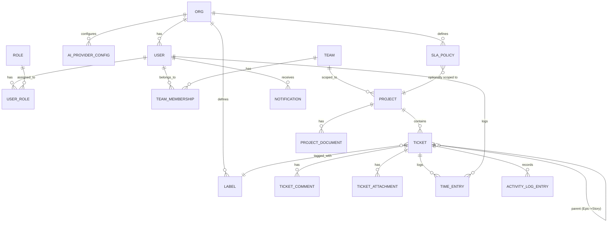
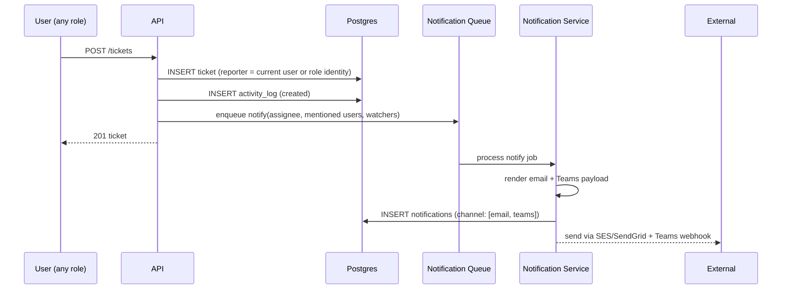
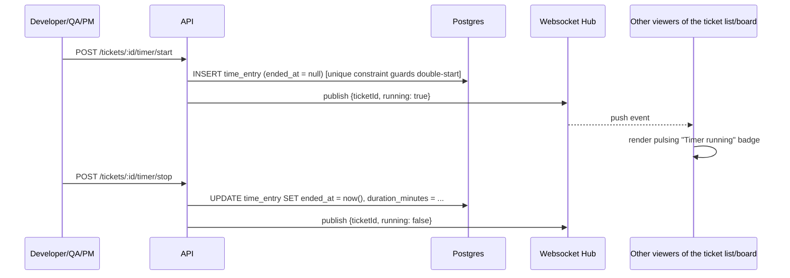
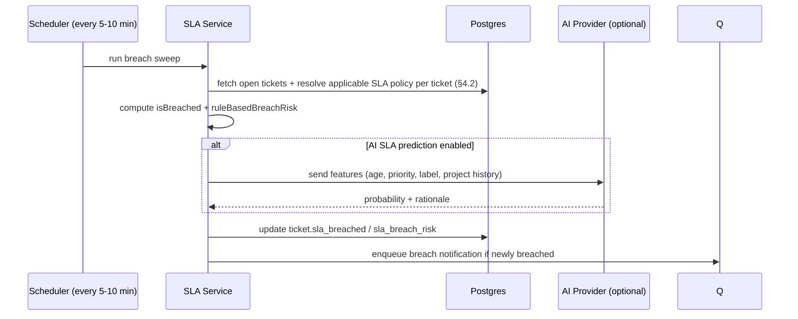
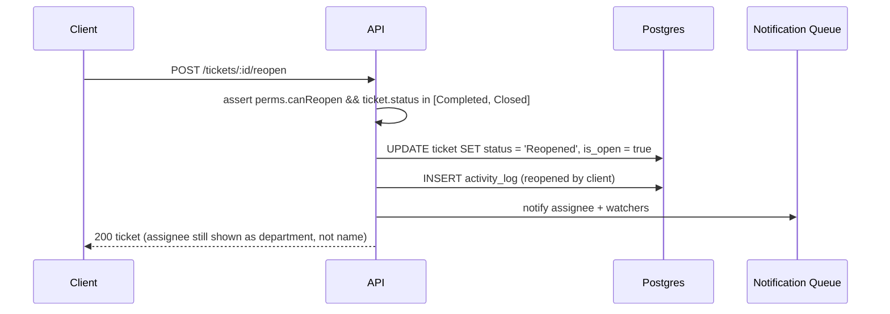

# Low-Level Design (LLD)

## ElevatoHub — Technical Design Specification

**Status:** Draft v1.0
**Companion docs:** `prd.md` (requirements), `designsystem.md` (UI/visual spec)
**Scope:** Translates the PRD into concrete data models, APIs, permission-enforcement logic, and core algorithms for a real backend implementation (the current artifact is front-end-only with mocked data).

---

## 1. Architecture Overview

```
┌───────────────────┐      ┌────────────────────┐      ┌─────────────────────┐
│   Web Client      │─────►│   API Gateway /    │─────►│   Application       │
│  (React SPA)      │ HTTPS│   BFF Layer        │ gRPC/│   Services          │
└───────────────────┘      └────────────────────┘  REST└─────────────────────┘
                                                          │      │      │
                          ┌───────────────────────────────┘      │      │
                          ▼                                      ▼      ▼
                 ┌──────────────────┐               ┌──────────────┐  ┌─────────────┐
                 │ Postgres (OLTP) │               │ Object Store  │  │ AI Provider  │
                 │ tickets/users/  │               │ (S3-compat)   │  │ Adapter Layer│
                 │ projects/time  │               │ attachments   │  │ (BYO-AI)     │
                 └──────────────────┘               └──────────────┘  └─────────────┘
                          │
                          ▼
                 ┌──────────────────┐      ┌────────────────────┐
                 │ Notification    │─────►│ Email (SES/       │
                 │ Service (queue) │      │ SendGrid) + Teams  │
                 └──────────────────┘      │ Graph API / webhook│
                                          └────────────────────┘
```

**Recommended stack** (pick per org standards; this is a reference, not a mandate):
- **Frontend:** React (already prototyped), React Query or similar for server state, role-aware route guards.
- **Backend:** Node.js/NestJS or equivalent typed framework, REST (or GraphQL if the org prefers a single flexible query surface — the permission-scoping logic in Section 5 works either way).
- **Database:** PostgreSQL — relational integrity matters here (tickets ↔ projects ↔ users ↔ time entries ↔ SLA policies all reference each other constantly).
- **Object storage:** S3-compatible bucket per environment, signed URLs for upload/download, versioning enabled for the "document folder" feature.
- **Queue:** SQS/RabbitMQ/Redis Streams for the notification fan-out (Section 8.1) and AI async jobs (Section 9).
- **Cache:** Redis for session, permission-matrix lookups, and SLA-policy lookups (hot path on every ticket read).

---

## 2. Data Model

### 2.1 Entity-Relationship summary



### 2.2 Core tables

**`users`**
| Column | Type | Notes |
|---|---|---|
| id | uuid, PK | |
| name | text | |
| email | text, unique | |
| avatar_initials | text | derived, cached |
| base_role_id | fk → roles.id | Admin / Director / PM / Developer / QA / Call Center / Customer Success / Operations / Client |
| seniority | enum | `lead`, `manager`, `senior_developer`, `junior_developer`, `intern`, `qa`, `null` (n/a for non-delivery roles) |
| status | enum | active / disabled |
| created_at, updated_at | timestamptz | |

**`roles`** — static seed data matching PRD §3.1 (id, key, label, group, default_scope).

**`teams`**
| Column | Type | Notes |
|---|---|---|
| id | uuid, PK | |
| name | text | e.g. "Mobile Squad" |
| lead_user_id | fk → users.id, nullable | who this team's Lead/Manager sub-role scopes to |

**`team_memberships`** (user_id, team_id) — many-to-many.

**`projects`**
| Column | Type | Notes |
|---|---|---|
| id | uuid, PK | |
| code | text, unique | e.g. `ATLAS` |
| name | text | |
| client | text | |
| pm_user_id | fk → users.id | |
| team_id | fk → teams.id, nullable | for team-scoped Lead/Manager visibility |
| status | enum | Active / Planning / On Hold / Completed |
| priority | enum | Critical/High/Medium/Low |
| start_date, end_date | date | |
| description | text | |
| created_at, updated_at | timestamptz | |

**`tickets`**
| Column | Type | Notes |
|---|---|---|
| id | uuid, PK | |
| display_id | text, unique | `ATLAS-1001` — generated from project code + sequence |
| project_id | fk → projects.id | |
| parent_ticket_id | fk → tickets.id, nullable | Story↔Epic link |
| title | text | |
| description | text | |
| type | enum | Story / Epic / Bug / Feature / Enhancement / Task / Change Request / Support |
| priority | enum | Critical/High/Medium/Low |
| status | enum | Open/Assigned/In Progress/In Review/QA Testing/Completed/Closed/**Reopened** |
| source | enum | Internal-PM / Call Center / Customer Success / Operations / Client Portal / Sales |
| label_id | fk → labels.id, nullable | |
| reporter_user_id | fk → users.id | drives Client/field-team scoping |
| assignee_user_id | fk → users.id, nullable | |
| watcher_user_ids | uuid[] | |
| start_date, due_date | date | |
| story_points, estimated_hours | numeric, nullable | full-access roles only |
| backlog_rank | integer, nullable | sequencing within Backlog view, separate from `priority` |
| created_at, updated_at | timestamptz | |

**`ticket_custom_fields`** (new — supports PRD §4.2 role-specific fields)
| Column | Type | Notes |
|---|---|---|
| id | uuid, PK | |
| ticket_id | fk → tickets.id | |
| field_group | enum | `developer`, `qa`, `pm` |
| field_key | text | e.g. `branch_link`, `test_case_id`, `sprint` |
| field_value | text/jsonb | |

Storing custom fields as key/value rows (rather than a wide sparse table) keeps the schema stable as new per-role fields get added later without migrations.

**`labels`**
| id | name | color_hash (derived, not stored — computed client & server-side identically) | created_by | created_at |

**`ticket_comments`** (id, ticket_id, author_user_id, body, mentioned_user_ids[], created_at)

**`ticket_attachments`** / **`project_documents`**
| id | ticket_id or project_id | file_name | file_size | mime_kind (image/video/doc) | storage_key | uploaded_by | created_at |

**`time_entries`** (drives PRD §4.4 and §8.5)
| Column | Type | Notes |
|---|---|---|
| id | uuid, PK | |
| ticket_id | fk → tickets.id | |
| user_id | fk → users.id | |
| started_at | timestamptz | |
| ended_at | timestamptz, nullable | null = **currently running** |
| duration_minutes | integer, generated/computed on stop | |

Unique partial index: `(ticket_id, user_id) WHERE ended_at IS NULL` — enforces "one active timer per person per ticket" at the database level, not just in application code.

**`sla_policies`** (new — PRD §9)
| Column | Type | Notes |
|---|---|---|
| id | uuid, PK | |
| org_id | fk | |
| priority | enum, nullable | null = applies to all priorities not otherwise matched |
| project_id | fk → projects.id, nullable | null = org-wide |
| client_name | text, nullable | optional client-level override |
| first_response_target_minutes | integer | |
| resolution_target_minutes | integer | |
| created_by, updated_by | fk → users.id | |
| created_at, updated_at | timestamptz | |

Resolution order when multiple policies could match a ticket: **client-specific > project-specific > priority-only > org default**.

**`activity_log`** (id, ticket_id or project_id, actor_user_id, action_type, action_text, ai_assisted boolean, created_at)

**`notifications`** (id, recipient_user_id, ticket_id, type, subject, body, channel[] (email/teams), read boolean, created_at)

**`ai_provider_configs`** (new — PRD §13)
| Column | Type | Notes |
|---|---|---|
| id | uuid, PK | |
| org_id | fk | |
| provider_type | enum | openai / anthropic / azure_openai / custom |
| display_name | text | |
| base_url | text | |
| api_key_encrypted | bytea | encrypted at rest (KMS), never returned by any read API |
| default_model | text | |
| is_default | boolean | |
| enabled_features | text[] | subset of: auto_categorize, summarize, smart_reply, sla_breach_prediction, duplicate_detection, root_cause_clustering |
| created_at, updated_at | timestamptz | |

**`ai_usage_log`** (id, org_id, feature, tokens_estimate, cost_estimate, ticket_id nullable, created_at) — powers the Admin usage dashboard in PRD §13.2.

---

## 3. Permission Enforcement

### 3.1 Scope model (already conceptually in the prototype, now server-side)

```ts
type Scope = "all" | "team" | "source" | "reporter";

interface RolePermissions {
  scope: Scope;
  dashboard: boolean;
  projects: boolean;
  board: boolean;
  comms: boolean;
  createProject: boolean;
  userManagement: boolean;
  manageLabels: boolean;
  manageSLA: boolean;        // new
  manageAI: boolean;         // new
  adminAnalytics: boolean;
  simpleDashboard: boolean;
  canReopen: boolean;
  timeTracking: boolean;
  workHoursVisibility: "none" | "own" | "team" | "org"; // new
}
```

`scope: "team"` is new relative to the prototype — it backs the Lead/Manager seniority behavior (PRD §3.2): same shape of dashboard as Director, but every query is additionally filtered to `project.team_id IN (teams the user leads)`.

### 3.2 Server-side query filter (applied at the repository layer, not just the API controller)

```ts
function ticketVisibilityFilter(user: User, perms: RolePermissions): SQLFragment {
  switch (perms.scope) {
    case "all":
      return sql`TRUE`;
    case "team":
      return sql`project_id IN (SELECT id FROM projects WHERE team_id = ANY(${user.ledTeamIds}))`;
    case "source":
      return sql`source = ${user.role.source}`;
    case "reporter":
      return sql`reporter_user_id = ${user.id}`;
  }
}
```

This filter is injected into **every** ticket read path (list, dashboard aggregates, analytics, export) at the query-builder level so there is no code path that can accidentally leak out-of-scope tickets — the previous (prototype) implementation filtered client-side after fetching everything, which is not acceptable once real data is involved.

### 3.3 Field-level redaction (Client identity masking, PRD §4/§8.4)

Assignee redaction cannot be a simple "don't send the field" — the UI still needs *something* to display. Compute it server-side so the raw assignee name never reaches the client's browser at all:

```ts
const DEPARTMENT_BY_TYPE: Record<TicketType, string> = {
  Story: "Engineering Team", Epic: "Engineering Team", Bug: "Engineering Team",
  Feature: "Engineering Team", Enhancement: "Engineering Team",
  Task: "Delivery Team", "Change Request": "Delivery Team", Support: "Support Team",
};

function serializeTicketForViewer(ticket: Ticket, perms: RolePermissions) {
  return {
    ...ticket,
    assigneeDisplay: perms.scope === "reporter"
      ? DEPARTMENT_BY_TYPE[ticket.type] ?? "Delivery Team"
      : ticket.assignee?.name,
    assigneeId: perms.scope === "reporter" ? null : ticket.assignee_user_id, // omit entirely, don't just hide in UI
  };
}
```

### 3.4 Seniority-based dashboard scoping (PRD §3.2)

```ts
function effectivePermissions(user: User): RolePermissions {
  const base = ROLE_PERMISSIONS[user.baseRoleId];
  if (user.seniority === "lead" || user.seniority === "manager") {
    return { ...base, scope: "team", dashboard: true, adminAnalytics: false };
  }
  return base;
}
```

---

## 4. Core Algorithms

### 4.1 Ticket ageing bucket (unchanged from prototype, now server-computed for consistency across dashboard/API/export)

```ts
function ageingBucket(ageDays: number): 0 | 1 | 2 | 3 | 4 {
  if (ageDays <= 2) return 0;
  if (ageDays <= 5) return 1;
  if (ageDays <= 10) return 2;
  if (ageDays <= 20) return 3;
  return 4;
}
```

### 4.2 SLA compliance & breach detection (new, replaces the flat mock in the prototype)

```ts
function resolveSLA(ticket: Ticket, policies: SLAPolicy[]): SLAPolicy {
  return (
    policies.find(p => p.clientName === ticket.project.client && p.priority === ticket.priority) ||
    policies.find(p => p.projectId === ticket.projectId && p.priority === ticket.priority) ||
    policies.find(p => p.priority === ticket.priority && !p.projectId && !p.clientName) ||
    ORG_DEFAULT_SLA_POLICY
  );
}

function isBreached(ticket: Ticket, policy: SLAPolicy): boolean {
  const elapsedMinutes = (Date.now() - ticket.createdAt.getTime()) / 60000;
  if (ticket.status === "Completed" || ticket.status === "Closed") {
    return ticket.resolvedAfterMinutes > policy.resolutionTargetMinutes;
  }
  return elapsedMinutes > policy.resolutionTargetMinutes; // still open and past target
}
```

`isBreached` runs as a scheduled job (every 5–10 minutes) over open tickets, writing a `sla_breached: boolean` + `sla_breach_at: timestamptz` onto the ticket row so dashboard reads stay O(1) rather than recomputing per request.

### 4.3 SLA breach *prediction* (AI-assisted, PRD §13.3)

Rule-based fallback (works even with no AI provider configured) plus an optional AI refinement:

```ts
function ruleBasedBreachRisk(ticket: Ticket, policy: SLAPolicy): "low" | "medium" | "high" {
  const pctElapsed = elapsedMinutes(ticket) / policy.resolutionTargetMinutes;
  if (pctElapsed >= 0.9) return "high";
  if (pctElapsed >= 0.6) return "medium";
  return "low";
}

// If an AI provider is configured with `sla_breach_prediction` enabled,
// the rule-based score is sent as a feature alongside ticket history
// (label, priority, project, historical resolution time for similar tickets)
// and the provider returns a probability + rationale string, shown as a tooltip.
```

### 4.4 Timer / time-entry duration

```ts
function totalLoggedMinutes(entries: TimeEntry[], now = Date.now()): number {
  return entries.reduce((sum, e) => {
    const end = e.endedAt ? e.endedAt.getTime() : now;
    return sum + (end - e.startedAt.getTime()) / 60000;
  }, 0);
}

function hasRunningTimer(entries: TimeEntry[]): boolean {
  return entries.some(e => e.endedAt === null);
}
```

The **running-timer indicator** (new UI requirement) is purely a function of `hasRunningTimer` — the frontend polls (or subscribes via websocket, preferred at scale) for tickets with an active entry and renders the pulsing badge described in `designsystem.md` §7.7. Recommended: a lightweight websocket channel per project (`project:{id}:timers`) pushing `{ticketId, running: true/false}` events rather than polling every ticket row.

### 4.5 Label color hashing (unchanged logic from prototype, now shared as a common utility so frontend and any server-rendered export match exactly)

```ts
function colorForLabel(label: string, palette: string[]): string {
  let h = 0;
  for (const ch of label) h = (h * 31 + ch.charCodeAt(0)) >>> 0;
  return palette[h % palette.length];
}
```

### 4.6 Work-hours rollup (PRD §8.5)

```sql
-- Hours logged today, per user, with drill-down ticket list available via a second query keyed on the same user+date
SELECT
  u.id AS user_id, u.name, u.seniority,
  SUM(EXTRACT(EPOCH FROM (COALESCE(te.ended_at, now()) - te.started_at)) / 3600) AS hours_today
FROM time_entries te
JOIN users u ON u.id = te.user_id
WHERE te.started_at::date = CURRENT_DATE
  AND (:teamFilter IS NULL OR u.id IN (SELECT user_id FROM team_memberships WHERE team_id = ANY(:teamFilter)))
GROUP BY u.id, u.name, u.seniority
ORDER BY hours_today DESC;
```

Drill-down (click a person's row): `SELECT ticket_id, ticket.display_id, ticket.title, duration FROM time_entries JOIN tickets ... WHERE user_id = :id AND started_at::date = :date`.

---

## 5. API Design (REST reference)

All endpoints sit behind auth middleware that resolves `RolePermissions` once per request and attaches it to the request context; every resource repository call takes that context and applies §3's scope filter.

| Resource | Method & Path | Notes |
|---|---|---|
| Auth | `POST /auth/login` | Real SSO/OAuth in production, replaces the prototype's role-switcher |
| Tickets | `GET /tickets` | Query params: status, priority, source, project, label, `view=mine\|all` (PRD §5) |
| Tickets | `POST /tickets` | Body includes `customFields[]` per §2.2 |
| Tickets | `PATCH /tickets/:id/status` | Triggers notification fan-out (§8.1) |
| Tickets | `POST /tickets/:id/reopen` | Only if `canReopen`; sets status=Reopened |
| Tickets | `GET /tickets/:id/history` | Merged comments + status changes + time entries, chronological |
| Backlog | `GET /projects/:id/backlog` | Story/Epic tickets, ordered by `backlog_rank` |
| Backlog | `PATCH /projects/:id/backlog/reorder` | Bulk rank update |
| Time entries | `POST /tickets/:id/timer/start` | Enforces DB unique constraint (§2.2) |
| Time entries | `POST /tickets/:id/timer/stop` | Computes `duration_minutes` |
| Time entries | `GET /reports/work-hours?date=&team=` | Backs §4.6 |
| Time entries | `GET /reports/work-hours/:userId/tickets?date=` | Drill-down |
| Labels | `GET/POST/DELETE /labels` | Admin only for write |
| SLA | `GET/POST/PATCH/DELETE /sla-policies` | Admin only for write |
| SLA | `POST /sla-policies/bulk-upload` | CSV/XLSX, returns a validation preview before commit |
| Users | `GET/POST/PATCH/DELETE /users` | Admin only for write; `PATCH` includes `seniority` |
| Teams | `GET/POST/PATCH /teams` | Assigns `lead_user_id`, membership |
| AI config | `GET/POST/PATCH/DELETE /ai-providers` | Admin only; API key write-only, never returned |
| AI config | `GET /ai-providers/usage` | Usage dashboard data |
| AI features | `POST /ai/categorize-suggestion` | Given draft title/description, returns suggested label |
| AI features | `POST /ai/summarize/:ticketId` | Returns a cached summary, regenerated on new comments |
| Notifications | `GET /notifications` | Bell dropdown feed |
| Comms log | `GET /comms-log` | Admin/full-access audit view |
| Analytics | `GET /analytics/project-wise` | PRD §8.2 table |
| Analytics | `GET /analytics/trend?period=month\|quarter\|year&project=` | Shared trend component data source |

---

## 6. Key Workflows (Sequences)

### 6.1 Create ticket → notify



### 6.2 Start/stop timer + live indicator



### 6.3 SLA breach scheduled check



### 6.4 Client reopen workflow



---

## 7. Frontend Architecture Notes

- **Route guards** derive `RolePermissions` from the authenticated session (server-provided, not client-computed) and hide/show nav items exactly as the prototype does today — but the *data* must also be scoped server-side (Section 3) so a modified client can't self-elevate.
- **"My Tasks" default view (PRD §5):** implemented as a default query param (`view=mine`) on the tickets route for Developer/QA base roles; the "All Tickets" toggle simply removes that param. No separate page/component needed — same list, different filter default.
- **Timer indicator:** subscribe to the websocket channel described in §6.2 scoped to whatever tickets are currently rendered (project or "my tickets"); fall back to a 15–30s poll if websockets aren't available in a given deployment.
- **Backlog view:** new top-level route, reuses the existing ticket-card and drag-and-drop primitives already built for the Kanban board (§7.3 in `designsystem.md`) rather than introducing a new drag library.
- **SLA admin screen & AI provider screen:** both are standard CRUD table + modal patterns already established (Users & Roles, Labels) — same components, new resource.

---

## 8. Security Considerations

- AI provider API keys: encrypted at rest via KMS envelope encryption; decrypted only in-memory at call time by the AI Adapter Layer, never logged, never returned by any GET endpoint (write-only field).
- SLA policy changes and AI provider changes are Admin-only and fully audit-logged (who changed what, when) — feeds the existing Comms & Tracking log pattern.
- Field-level redaction (§3.3) happens server-side; the client never receives the real assignee identity for `reporter`-scoped viewers, so there's no way to expose it via devtools/network inspection.
- Rate limiting on `POST /tickets` and AI endpoints to prevent abuse from the Call Center/Client intake channels.
- Signed, time-limited URLs for attachment/document downloads (no permanent public URLs).

---

## 9. AI Adapter Layer (Bring-Your-Own-AI)

A single internal interface every feature calls through, so swapping providers never touches feature code:

```ts
interface AIAdapter {
  categorize(input: { title: string; description: string; existingLabels: string[] }): Promise<{ label: string; confidence: number }>;
  summarize(input: { ticketId: string; comments: string[] }): Promise<{ summary: string }>;
  suggestReply(input: { ticketId: string; history: string[] }): Promise<{ draft: string }>;
  predictBreachRisk(input: SLAFeatureVector): Promise<{ risk: "low" | "medium" | "high"; rationale: string }>;
  findSimilar(input: { title: string; description: string; projectId: string }): Promise<{ ticketId: string; similarity: number }[]>;
}

class OpenAIAdapter implements AIAdapter { /* maps to org's configured base_url + api_key */ }
class AnthropicAdapter implements AIAdapter { /* same interface, different wire format */ }
class CustomAdapter implements AIAdapter { /* org-hosted model behind their own API contract */ }
```

The Admin AI-config screen simply selects which concrete adapter backs `AIAdapter` per org (and optionally per feature, per PRD §13.2), and every call is wrapped with the usage logging (`ai_usage_log`) and the "AI-assisted" activity-log tag (PRD §13.4) regardless of which adapter is active.

---

## 10. Rollout Mapping to PRD Phases

| PRD Phase | LLD components involved |
|---|---|
| Phase 1 | §2 schema, §3 permission enforcement, auth, object storage |
| Phase 2 | §6.1 create/notify flow refinements, Backlog route (§7), custom fields table (§2.2) |
| Phase 3 | §4.6 work-hours rollup + drill-down, §2.2 `sla_policies` + bulk upload, seniority scoping (§3.4) |
| Phase 4 | §9 AI adapter layer, §4.3 breach prediction, §6.3 |
| Phase 5 | Real email/Teams delivery (§6.1 external send step), exports |
